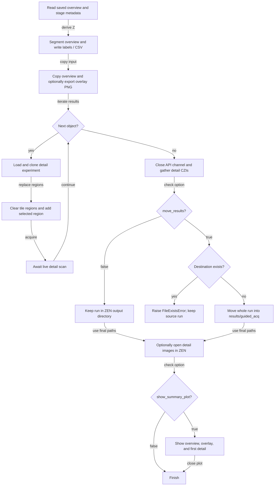
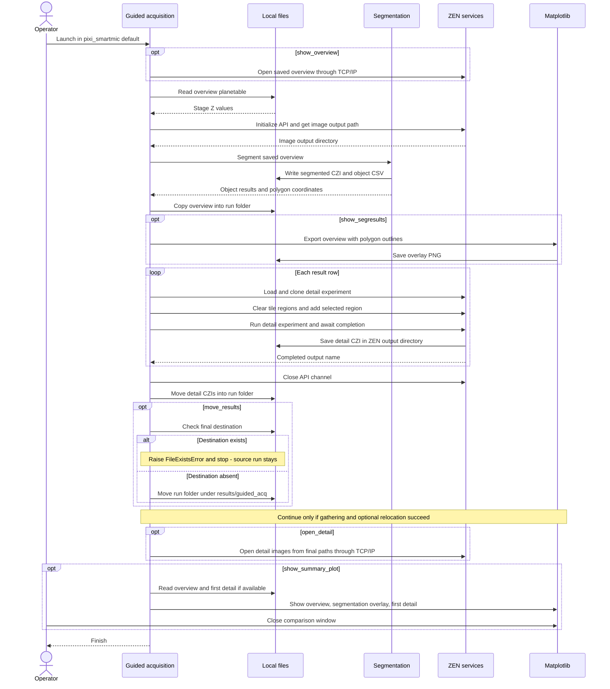

# Guided acquisition with ZEN-API

[Open the visual walkthrough](https://sebi06.github.io/smartmicroscopy/examples/control_zen_via_zenapi/guided_acquisition_docs/guided-acquisition.html) for the workflow, output locations, and end-of-run options.

[zenapi_guidedacq.py](../zenapi_guidedacq.py) segments an existing overview CZI,
converts detected objects into tile regions, and runs a live ZEN detail scan
for each result row. The overview acquisition is currently simulated with
a saved image; **the detail acquisitions are real microscope operations**.

## Before running

1. Install the workshop's `pixi_smartmic:default` environment as described in
   the [workshop README](../../../README.md).
2. Start a compatible ZEN installation with ZEN-API access and TCP/IP commands
   enabled. The script opens images through TCP/IP and acquires through ZEN-API.
3. Configure the gateway connection in `my_config.ini` beside the script.
   Keep credentials private. This script currently selects that filename,
   not `config.ini`.
4. Put the overview at `data/OverViewScan.czi` under the workshop root, or
   change `filepath_overview` inside `main()`.
5. Make the detail experiment `ZEN_API_GuidedAcq` available in ZEN, or change
   `detail_exp`. Prepare a suitable tile experiment and check its acquisition
   settings before running.
6. Confirm the overview's stage coordinates and Z position are appropriate
   for the current sample. Check microscope travel, focus, and illumination
   settings with the operator before starting.

## Launch from Windows CMD

Run from the workshop root, replacing the example checkout path if necessary:

```bat
cd /d "F:\Pixi_Projects\zen_czi\smartmicroscopy"
pixi run --locked -e default python "examples\control_zen_via_zenapi\zenapi_guidedacq.py"
```

`pixi_smartmic` is the workspace name; `default` is the environment name
passed to `-e`. No Conda activation or VS Code interpreter selection is
needed. Use this workshop environment, not the separate `zen-pixi-workspace`.

The script has no command-line argument parser. Edit its configuration and
the final `asyncio.run(main(...))` call to change behavior. Do not pass
`--move-results` or `--show-summary-plot`: those CLI flags do not exist.

## Configure the run

The current launch call enables moving results and the final comparison:

```python
asyncio.run(main(move_results=True, show_summary_plot=True))
```

The parameters of `main()` are:

- `region_type="polygon"`: use object polygons. Alternatives are `"rectangle"`
  and `"ellipse"`, derived from object bounding boxes.
- `open_detail=False`: when `True`, open every completed detail CZI in ZEN
  from its final location.
- `move_results=False`: when `True`, move the whole run folder under the
  workshop's `results/guided_acq`. **The launch call sets this to `True`.**
- `show_summary_plot=False`: when `True`, show the overview, segmentation
  overlay, and first detail scan side by side. **The launch call sets this
  to `True`.** Close the window to let the script finish.

Other settings are inside `main()`:

- `show_overview=True` opens the saved overview in ZEN; it does not acquire
  a new overview. The `gca_run_overviewscan()` invocation is commented out.
- `show_segresults=True` exports the overview with polygon outlines as PNG.
- `verbose=False`; enabling it also saves a cloned detail experiment as
  `<detail_exp>_cloned` with override allowed. That experiment remains in
  ZEN's experiment storage, not the run results folder.
- Segmentation uses channel index `0`, Gaussian filtering with size `7`,
  triangle thresholding, and minimum object size `100000`. The call also
  passes `max_holesize=1000`; see
  [processing_tools.py](../processing_tools.py) for its processing implementation.

The stage Z value is the median overview planetable Z value. Polygon and
bounding-box stage coordinates are converted from micrometres to metres
for the ZEN tile-region requests.

## What happens

1. Read the saved overview and derive a stage Z position.
2. Query ZEN's image output directory and segment the overview.
3. Copy the overview and export a polygon-overlay preview.
4. For each detected result row, load and clone the detail experiment,
   clear its tile regions, add the selected region, and await acquisition.
5. Close the API channel, gather the detail CZIs into the run folder, and
   optionally move that folder to the workshop results directory.
6. Optionally open the detail scans in ZEN, then show the final comparison.

## Flowchart

The overview is a saved input; the detail-scan loop performs live acquisition.
The chart shows the normal workflow and the destination-collision branch.
Other acquisition or filesystem errors propagate and stop the run.

[Editable flowchart source](guided-acquisition-flowchart.mmd)



## Sequence diagram

ZEN services include experiment acquisition, tile-region operations, and
TCP/IP image-opening commands. File reads and writes are shown separately.
An exception stops execution; the messages below the collision branch apply
only when gathering and optional relocation succeed.

[Editable sequence source](guided-acquisition-sequence.mmd)



## Output files and locations

The run starts under ZEN's configured image output directory:

```text
<ZEN image output directory>\
  GA_<UTC date>_<UTC time>\
    OverViewScan_OV.czi
    OverViewScan_OV.png
    OverViewScan_seg.czi
    OverViewScan_seg.csv
    zenapi_detail_0.czi
    zenapi_detail_1.czi
    ...
```

Names beginning with `OverViewScan` follow the input overview's basename.
The PNG is created only when `show_segresults=True`. Detail files are
generated for the detected result rows, so their count varies.

When `move_results=True`, the complete run folder moves to:

```text
F:\Pixi_Projects\zen_czi\smartmicroscopy\results\guided_acq\GA_<UTC date>_<UTC time>\
```

The destination is derived from the workshop root, so it follows your checkout
if you put the workshop elsewhere. When `False`, the folder stays under ZEN's
image output directory. The source overview in `data` is copied, not moved.
Unrelated files in ZEN's output directory are not collected.

An existing destination run folder raises `FileExistsError`; it is not
overwritten, and the newly gathered files remain at the ZEN-side location.
Relocation runs only after successful acquisition. If acquisition or moving
fails, inspect the logged paths for partial results; there is no automatic
failure cleanup or rollback.

## Final comparison

The final plot reads channel `0` and displays:

1. The original overview from `filepath_overview`.
2. The same overview with detected polygon outlines, not the label-mask CZI.
3. The first detail scan from its final output location.

If there is no detail scan, the last panel says **No detail scans acquired**.
The comparison window is interactive and blocks until closed. It is not
automatically saved; the earlier overlay PNG is a separate export.

## Troubleshooting

- **Cannot find the workshop:** start from the workshop root or a subdirectory.
- **Missing overview or gateway INI:** check the configured paths inside `main()`.
- **Connection or TCP/IP failure:** verify ZEN, API access, gateway settings,
  and the TCP/IP image-opening service.
- **Wrong detail regions:** verify input metadata, sample alignment, experiment
  settings, segmentation, and coordinate units before rerunning.
- **No detected objects:** inspect the overview channel and segmentation
  parameters. The detail loop uses the segmentation results, not a fixed count.
- **Result move fails:** check permissions, disk space, destination collisions,
  and file locks. Files open in ZEN may prevent a move on Windows.

## Visual documentation

- [Rendered walkthrough](guided-acquisition.html)
- [Editable visual source](guided-acquisition.src.html)
- [Application source](../zenapi_guidedacq.py)
- [Segmentation implementation](../processing_tools.py)

The visual walkthrough describes source behavior, not a recorded hardware run.
